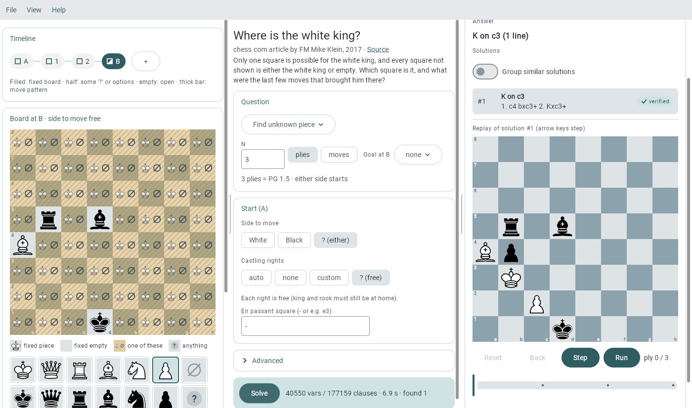
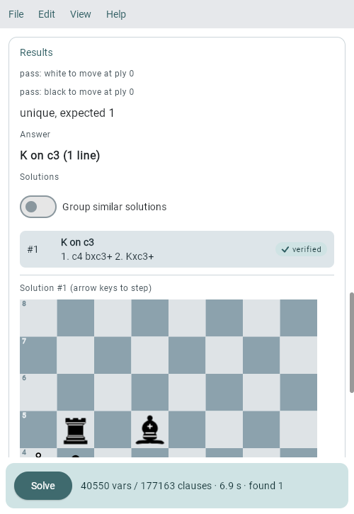

# sat-chess-kotlin

Retrograde chess puzzles solved with SAT, in the browser. Set up a position, ask how it came about,
and a SAT solver finds every line of play that fits. A move generator verifies each one.

**Try it in the browser: <https://manfredscheucher.github.io/sat-chess-kotlin/>**

<p>
  
  
</p>

A puzzle is a window of N plies with constraints: start and target board, unknown squares, "a king
or nothing stands here", move patterns, mate or stalemate at the end. All answers are cooperative
(helpmate style): a forced mate against every defence is out of scope. Examples are built in: small
demos and the 5 chess.com retrograde puzzles.

SAT chess is in early development. Feedback is very welcome:
[manfred.scheucher@proton.me](mailto:manfred.scheucher@proton.me?subject=sat-chess%20feedback&body=hi%20manfred%2C%0A%0A)

## The app

A menu bar (File / View / Help) over panels with draggable dividers, side by side when the window
is wide and stacked when it's narrow (View -> Layout to force portrait or landscape).

- **Board**: timeline of plies, board editor with palette, drag & drop, or a dialog per square.
  Long press or right click gives a square several options.
- **Question**: helpmate, proof game, last move, N in plies or moves, side to move, castling, e.p.
- **Results**: all solutions, optionally grouped, with a replay board (Reset, Back, Step, Run).

File -> Examples, Load, Save (JSON) and Share link (the puzzle in the URL). Help explains the rest.

## The code

- `core`: chess rules and move generator, puzzle format, SAT encoder and solver driver (jvm, js)
- `worker`: runs the solver in a Web Worker, so the page stays responsive
- `composeApp`: the Compose UI (web, desktop)
- `cli`: command line, also writes DIMACS
- `puzzles/`: the example puzzles as JSON, embedded by `scripts/gen_puzzles.py`

The SAT solvers come from [ksat](https://github.com/manfredscheucher/ksat) (Kotlin ports of MicroSAT,
MiniSat, CaDiCaL, kissat), included as the submodule `sat-solvers-kotlin`. Clone with
`git clone --recursive`, or run `git submodule update --init --recursive` afterwards.

## Build & run

JDK 21.

```bash
./scripts/runWeb.sh        # web dev-server (http://localhost:8608)
./scripts/buildWeb.sh      # production website
./scripts/deployPages.sh   # build the website -> gh-pages branch
./scripts/runJvm.sh        # desktop
./scripts/runCli.sh solve puzzles/chess-com-5/4.json --all --verbose
./gradlew :composeApp:jvmTest :core:jvmTest   # the tests
```

The tests solve the demos and chess.com #2 and check that every example loads, plus the rules, the
encoder and the UI. All other bundled puzzles are solved only with `-PslowTests`.

## Documentation

The full specification, what was built and why, is in [`doc/spec.md`](doc/spec.md). The encoding is
in [`doc/encoding.md`](doc/encoding.md), the website and other targets in
[`doc/platforms.md`](doc/platforms.md).

## License & credits

MIT (see [`LICENSE`](LICENSE)), except:

- the puzzles in `puzzles/`: the credited composers' works, see [`puzzles/NOTICE.md`](puzzles/NOTICE.md)
- the piece graphics: cburnett set by Colin M.L. Burnett, BSD 3-clause, see [`doc/pieces.md`](doc/pieces.md)
- the font: DejaVu Sans Mono, see [`doc/licenses/LICENSE_DEJAVU.txt`](doc/licenses/LICENSE_DEJAVU.txt)

The app's About dialog shows all bundled license texts.
